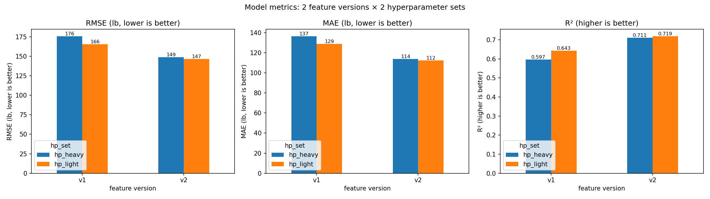
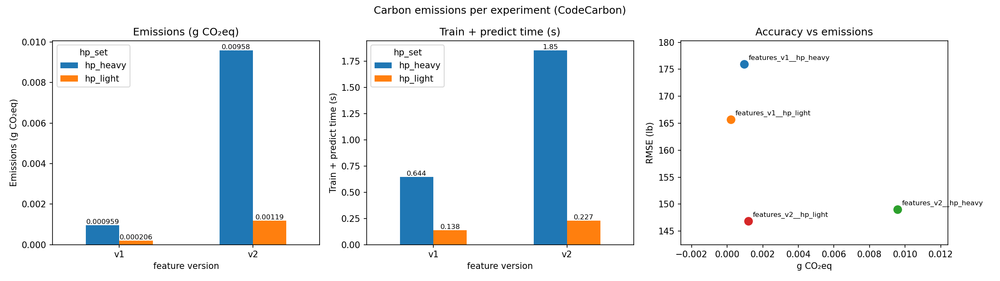
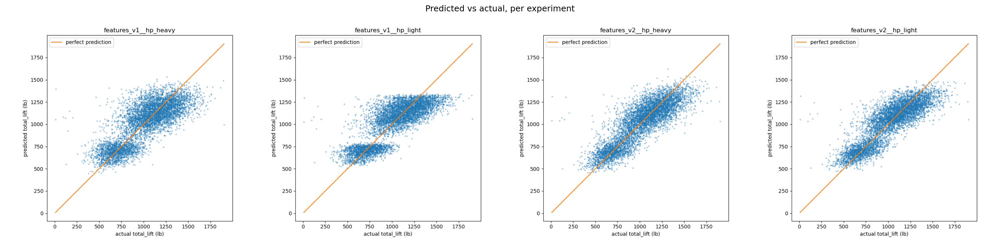

# Athletes total-lift: ML pipeline with a feature store and carbon tracking

Predicts an athlete's **total lift** (deadlift + clean & jerk + snatch + back squat) from the
CrossFit `athletes.csv` data, using a reproducible pipeline that combines:

| Layer | Tool | Role |
|:--|:--|:--|
| MLOps platform | **MLflow** (tracking + Projects) | pipeline entry point, one parent run per pipeline, nested run per experiment, model + plot artifacts |
| Feature store | **Feast** (local: file offline store, SQLite online store) | two versioned feature services; training data via point-in-time joins; online serving demo |
| Carbon tracking | **CodeCarbon** (offline tracker) | energy (Wh) and emissions (g CO₂eq) per experiment, logged to MLflow |
| Model | **scikit-learn** `RandomForestRegressor` | same algorithm in every run, two hand-picked hyperparameter sets (no AutoML) |

```
athletes.csv ──▶ prepare_data ──▶ Feast offline store (parquet)
                                   │
                         register_features (feast apply)
                                   │
        ┌──────── feature service v1 ────────┐   ┌──────── feature service v2 ────────┐
        │  hp_light            hp_heavy      │   │  hp_light            hp_heavy      │
        └───────────── 4 MLflow runs, each wrapped in a CodeCarbon tracker ──────────┘
                                   │
                    compare (metrics, plots, emissions) ──▶ reports/
                                   │
                  online demo: materialize ─▶ get_online_features ─▶ best model
```

## Experiment design

**Same rows, same labels, same train/test split for every run** (the split is fixed once, by
athlete, in `labels.parquet`), so differences come only from the features and hyperparameters.

| Feature version | Feast feature service | Features |
|:--|:--|:--|
| **v1** | `athlete_features_v1` = `athlete_basic` | age, height, weight, gender |
| **v2** | `athlete_features_v2` = `athlete_basic` + `athlete_engineered` | v1 + BMI, region, years training (ordinal), # answers per survey question, began with a coach, trains multiple times a day, played college sports |

| Hyperparameter set | n_estimators | max_depth | min_samples_leaf | max_features |
|:--|--:|--:|--:|--:|
| `hp_light` | 100 | 10 | 5 | 0.5 |
| `hp_heavy` | 300 | 20 | 2 | 1.0 |

4 experiments = {v1, v2} × {hp_light, hp_heavy}. All values live in [`config.yaml`](config.yaml).

The lift columns are never used as features (they *are* the target). Data cleaning follows the
course-provided code, with the `v2['deadlift']` typo fixed and `athlete_id` kept as the feature
store's entity key.

## Setup

```bash
conda create -n athletes-mlops python=3.11 -y
conda activate athletes-mlops
pip install -r requirements.txt
```

Put the course file at `data/raw/athletes.csv.zip` (it is git-ignored; `athletes.csv` also works
if you change `data.raw_path` in `config.yaml`).

## Run

```bash
python -m src.pipeline                      # or: make run
```

Or as an MLflow Project:

```bash
MLFLOW_TRACKING_URI=sqlite:///$(pwd)/mlflow.db \
  mlflow run . --env-manager local --experiment-name athletes-total-lift
```

Then explore:

```bash
make ui         # MLflow UI → http://localhost:5050  (5000 is taken by AirPlay on macOS)
make feast-ui   # Feast UI  → http://localhost:8888
```

In the MLflow UI, open experiment **athletes-total-lift**, expand the `pipeline` run and select
the four nested runs → **Compare** to see metrics, parameters and emissions side by side.
Each run's **Artifacts** tab has its plots and the logged model.

**No course data handy?** `make smoke` runs the whole pipeline on a generated synthetic file
with the same columns.

## Outputs

| Where | What |
|:--|:--|
| `reports/results.csv`, `reports/results.md` | metrics + time + energy + emissions for all 4 runs |
| `reports/metrics_comparison.png` | RMSE / MAE / R² by feature version × hyperparameter set |
| `reports/emissions_comparison.png` | emissions, runtime, and accuracy-vs-emissions trade-off |
| `reports/pred_vs_actual_grid.png` | qualitative comparison: predicted vs actual for each run |
| MLflow run artifacts | per run: `pred_vs_actual.png`, `residuals.png`, `feature_importance.png`, model |
| `emissions/emissions.csv` | raw CodeCarbon log |

## Results

> Fill in after running on the course data (copy `reports/results.md`).

| run | feature version | hp set | MAE | RMSE | R² | time (s) | energy (Wh) | g CO₂eq |
|:--|:--|:--|--:|--:|--:|--:|--:|--:|
| | | | | | | | | |





**Quantitative:** _[which feature version wins, by how much; does the heavier forest help?]_

**Qualitative:** _[shape of predicted-vs-actual and residual plots; which features dominate the importance plots]_

**Carbon:** _[emission ratio heavy vs light; whether the extra emissions buy accuracy]_

### Notes on the emission numbers

CodeCarbon's offline tracker estimates energy from hardware power readings where available
(RAPL on Linux) and otherwise from the CPU's rated power, then converts to CO₂eq using the grid
carbon intensity for `carbon.country_iso_code`. On a laptop the absolute values are small and
approximate; the **relative** differences between runs are the meaningful comparison.

## Repository layout

```
├── config.yaml              # data paths, feature versions, hyperparameter grid
├── MLproject, python_env.yaml
├── feature_repo/
│   ├── feature_store.yaml   # Feast config (local provider)
│   └── features.py          # entity, 2 feature views, 2 feature services (= versions)
├── src/
│   ├── pipeline.py          # orchestrates all steps under one MLflow parent run
│   ├── prepare_data.py      # clean data, build feature tables + labels/split
│   ├── register_features.py # feast apply
│   ├── train.py             # one experiment: Feast → train → CodeCarbon → MLflow
│   ├── compare.py           # tables and comparison plots
│   └── online_demo.py       # materialize + online features + best model
├── tests/                   # synthetic data generator + smoke config
└── reports/                 # comparison outputs (commit these after your run)
```
